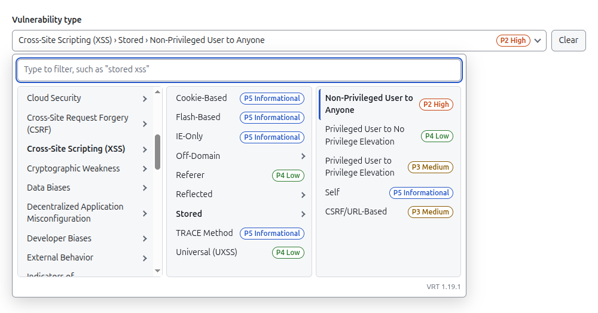

# vrt-input

A React component and a framework-free core for choosing entries from Bugcrowd's
[Vulnerability Rating Taxonomy](https://github.com/bugcrowd/vulnerability-rating-taxonomy) (VRT).

**[Try the demo](https://0xmattijs.github.io/vrt-input/)**



- Choose a category, subcategory, and variant from a hierarchical menu, or type to filter, such as
  "stored xss".
- Use three linked dropdowns instead, bound to the same value.
- Show the VRT priority, P1 to P5, of the chosen entry and of each entry in the menu, if you want it.
- Validate IDs, and get the replacement for IDs that were removed from the VRT.
- Use the bundled VRT 1.19.1, or your own taxonomy in the same format.

## Install

```sh
npm install @alcyonsecurity/vrt-input
```

```tsx
import { VrtInput } from '@alcyonsecurity/vrt-input';
import '@alcyonsecurity/vrt-input/styles.css';
```

## Use the component

The value is a dotted VRT ID, such as `cross_site_scripting_xss.stored.self`.

```tsx
// Menu: a button that opens columns for category, subcategory, and variant, and a filter field.
<VrtInput value={vrtId} onChange={(id, result) => setVrtId(id)} />

// Dropdowns: three native dropdowns for the same value.
<VrtInput value={vrtId} onChange={setVrtId} mode="dropdowns" />

// Show priorities, and accept a category or subcategory on its own.
<VrtInput value={vrtId} onChange={setVrtId} showPriority allowPartial />
```

| Prop | Default | Description |
|---|---|---|
| `value` / `defaultValue` | — / `''` | Controlled or uncontrolled VRT ID. |
| `onChange` | — | `(value, result) => void`. `result` is a `VrtResult`. Clearing passes `''`. |
| `mode` | `'menu'` | `'menu'` or `'dropdowns'`. |
| `taxonomy` | bundled VRT | A taxonomy from `createTaxonomy`. See [Use your own taxonomy](#use-your-own-taxonomy). |
| `showPriority` | `false` | Shows the priority of the chosen entry, and of each entry in the menu. |
| `allowPartial` | `false` | Accepts a category or subcategory that has more specific entries. |
| `maxLength` | `256` | Longest accepted value. |
| `name` | — | Adds a hidden form field with the normalized ID, or `''` when the value isn't valid. |
| `id` | — | ID of the menu button, or of the category dropdown, for an external `<label>`. |
| `messages` | English | Texts in another language, such as `nl`. See [Languages](#languages). |
| `label`, `placeholder`, `readOnly`, `disabled`, `className` | | Standard. |

`VrtMenu`, `VrtDropdowns`, and `PriorityBadge` are exported separately if you want to compose your own
layout.

### Choose a mode

Both modes edit the same value, so you can switch between them, or show both, without converting
anything.

- **Menu** is the default. It shows all three levels at once and finds entries by name or ID. Use it
  where there's room for a 760-pixel menu.
- **Dropdowns** use the browser's own dropdowns. Use them on narrow screens, on touch devices, or in
  dense forms. Each dropdown lists only the entries under the one before it, and changing a level clears
  the levels below it.

The component doesn't switch modes by itself. To switch by screen width, pass `mode` from a media query:

```tsx
const narrow = useMediaQuery('(max-width: 640px)'); // Your own hook.
<VrtInput value={vrtId} onChange={setVrtId} mode={narrow ? 'dropdowns' : 'menu'} />
```

### Entries that have children and a priority

Most VRT entries with children have no priority of their own, so you must choose a child. A few, such as
**Server Security Misconfiguration › Fingerprinting/Banner Disclosure**, have both. For those, the menu
and the dropdowns offer **No specific variant**, which chooses the entry itself. With `allowPartial`,
every entry with children offers this option.

### Keyboard

| Where | Key | Action |
|---|---|---|
| Menu button | Enter, Space, Down, Up | Open the menu. Focus moves to the filter field. |
| Filter field | Typing | Filter. The results replace the columns. |
| Filter field | Down, Up, Enter | Move through the results, and choose one. |
| Filter field | Down, with no filter | Move to the category column. |
| Column | Down, Up, Home, End | Move through the entries. |
| Column | Right, or Enter on an entry with children | Open the next column. |
| Column | Left | Go back a column. |
| Column | Enter or Space on an entry without children | Choose it. |
| Column | Typing | Start a filter. |
| Anywhere in the menu | Escape | Clear the filter, or close the menu. |

## Use the core without React

```ts
import { evaluate, search } from '@alcyonsecurity/vrt-input/core';

const result = evaluate('cross_site_scripting_xss.stored.self');
result.valid;       // true
result.normalized;  // 'cross_site_scripting_xss.stored.self'
result.path;        // [Cross-Site Scripting (XSS), Stored, Self] as nodes
result.priority;    // 5

search('stored xss', { limit: 3 });
// [{ node: …, ranges: [{ level: 1, start: 22, end: 25 }, { level: 2, start: 0, end: 6 }] }, …]
```

`evaluate(input, { taxonomy, allowPartial, maxLength })` returns:

- `valid`: true when the ID names an entry that may be chosen, with no errors.
- `normalized`: the ID, trimmed and lowercase, or `null` when it isn't valid.
- `node` and `path`: the entry, and the entries from its category down. When a level is unknown, `path`
  holds the levels that resolved.
- `priority`: `1` to `5`; `'varies'` when the VRT sets no fixed priority; or `null` when the entry has
  none of its own or the value isn't valid.
- `issues`: errors and warnings, each with a `code`, an English `message`, and the `params` the message
  is built from. `formatIssue(issue, nl)` returns the message in another language.
- `taxonomyVersion`: the version the ID was checked against, such as `1.19.1`.

| Code | Severity | When |
|---|---|---|
| `TOO_LONG` | Error | The input is longer than `maxLength`. It isn't parsed. |
| `INVALID_FORMAT` | Error | The input isn't one to three names of `a`–`z`, `0`–`9`, and `_`, separated by dots. |
| `TOO_DEEP` | Error | The ID has more than three levels. |
| `UNKNOWN_ID` | Error | A level doesn't exist. `level` says which. |
| `DEPRECATED` | Error | The ID was removed from the VRT. `params.replacement` is the new ID, or `null`. The component offers a button to use the replacement. |
| `INCOMPLETE` | Error | The entry has children and needs one, unless `allowPartial` is set. The component shows this as a hint, not as an error. |
| `NOT_CANONICAL` | Warning | The ID has uppercase letters or spaces. `normalized` has the fixed ID. |

`search(query, { taxonomy, allowPartial, limit })` finds entries whose names along the path contain
every word of the query, in any order. Words also match IDs, so "idor" finds
`broken_access_control.idor`. Matches at the start of a word, and in the entry's own name, rank first.
Each result has the character `ranges` to highlight per level.

The React hook `useVrt(value, options)` returns the same result as `evaluate`, memoized.

## Use your own taxonomy

Pass a taxonomy in the VRT JSON format, such as a newer release, a release in another language, or
your own extensions:

```ts
import { createTaxonomy } from '@alcyonsecurity/vrt-input/core';
import source from './vulnerability-rating-taxonomy.json';
import deprecated from './deprecated-node-mapping.json';

// Create it once, outside render.
const taxonomy = createTaxonomy({ ...source, version: '1.20' }, { deprecated });

<VrtInput taxonomy={taxonomy} value={vrtId} onChange={setVrtId} />
```

`createTaxonomy` checks the data and throws a `TypeError` that names the bad node: IDs must be 1–100
characters of `a`–`z`, `0`–`9`, and `_`; names must be 1–200 characters; priorities must be 1–5 or `null`;
and the taxonomy can have at most three levels and 10,000 entries. The `type` field in Bugcrowd's files
is ignored, because the level follows from the depth.

Bugcrowd's files don't include the version, so pass `version` yourself. The value stays the plain ID,
as in Bugcrowd's API. If you store values across VRT releases, store `result.taxonomyVersion` next to
the ID.

## Languages

The components ship in English (`en`, the default) and Dutch (`nl`). Set the language for a whole app
with a provider, or for one component with the `messages` prop:

```tsx
import { VrtInput, VrtMessagesProvider, nl } from '@alcyonsecurity/vrt-input';

<VrtMessagesProvider messages={nl}>
  <App />
</VrtMessagesProvider>

<VrtInput value={vrtId} onChange={setVrtId} messages={nl} />
```

A catalog covers every text of the component: labels, buttons, issue messages, priority names, and
screen reader texts. Taxonomy names, such as "Cross-Site Scripting (XSS)", come from the taxonomy. To
show them in another language, pass a taxonomy with translated names.

To change a few texts, pass a partial catalog. Anything it leaves out comes from the provider, or from
English:

```tsx
<VrtInput messages={{ ui: { label: 'Finding type' } }} />
```

## Security

The components render all text through React, which escapes it, so IDs, taxonomy names, and filter
queries can't inject HTML. If you use the core or your own UI, follow these rules:

- **Store the normalized ID, not the raw input.** `onChange` passes the value as set, valid or not.
  Persist `result.normalized` only when `result.valid` is true. The hidden form field from `name` does
  this for you.
- **Escape issue messages when you render them.** Messages quote IDs only after they match the ID
  pattern, but insert them as text anyway, never as HTML.
- **Input length is limited.** `evaluate` rejects input longer than `maxLength` (default 256 characters)
  with one `TOO_LONG` error. The longest ID in VRT 1.19.1 has 139 characters. The filter reads at most
  100 characters and 10 words.
- **Custom taxonomies are checked.** `createTaxonomy` rejects malformed data and taxonomies with more
  than 10,000 entries.

## Accessibility

The components aim for WCAG 2.2 AA:

- The menu button names its label and the chosen entry, such as "Vulnerability type, Cross-Site
  Scripting (XSS) › Stored › Self", and says it opens a dialog.
- Each column is a listbox. The active entry is tracked with `aria-activedescendant`, so focus stays on
  the column, and entries that open another column say how many entries they hold, such as "Stored,
  6 options".
- The filter field is a combobox that controls the results listbox. A status message announces the
  number of results.
- Issues are linked to the control with `aria-describedby`, and announced politely when they change.
- The dropdowns are native `<select>` elements in a fieldset with the label as its legend.
- Text meets 4.5:1 contrast and control borders and focus outlines meet 3:1, in light and dark mode.
  Priorities are always shown as text, not only as color.
- In forced-colors modes such as Windows High Contrast, the active and chosen entries and the filter
  matches use system highlight colors.

`test/a11y.test.tsx` runs axe-core on every component state, including the open menu, and
`test/contrast.test.ts` checks the color tokens. If you override `--vrt-*` colors, check their contrast
too.

## Development

To contribute, see [CONTRIBUTING.md](CONTRIBUTING.md).

```sh
npm test            # unit, component, accessibility, and contrast tests
npm run typecheck
npm run build       # dist/ with ESM, CJS, types, and styles.css
npm run dev         # demo page
npm run build:demo  # static demo in demo/dist
npm run fetch-vrt -- v1.19.1  # regenerate src/core/data/vrt.ts from a VRT release
```

The demo deploys to GitHub Pages on every push to `master`.

CI runs the typecheck, tests, and build on Node 22 and 24 with React 18 and 19 for every push to
`master` and every pull request. Releases follow the same process as
[cvss-input](https://github.com/0xMattijs/cvss-input#release): a dated `CHANGELOG.md` entry, a pull
request, and a `v*` tag that publishes to npm with trusted publishing.

## License

MIT. The bundled VRT data is © Bugcrowd, licensed under Apache-2.0; see [NOTICE](NOTICE).
